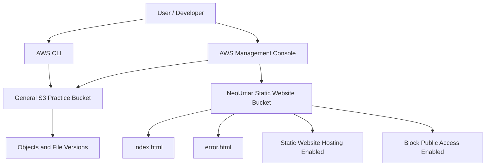

# AWS S3 Architecture Documentation

## 1. Project Overview

This document describes the Amazon S3 architecture implemented during the AWS Cloud Engineering Bootcamp.

The project covers two S3 buckets with different purposes:

- General-purpose S3 storage and versioning practice.
- Static website hosting using S3.

**AWS Region:** Asia Pacific (Hyderabad) — `ap-south-2`

## 2. Architecture Diagram

## 3. S3 Bucket Configuration

### Bucket 1: General S3 Practice

**Bucket name:** `neoumar-s3-practice-2026-umar`

**Purpose:** Practising S3 object storage, uploads, downloads, versioning and AWS CLI operations.

Configuration:

- Private S3 bucket.
- Versioning enabled.
- Bucket Owner Enforced object ownership.
- ACLs disabled.
- All four Block Public Access settings enabled.
- Used for uploading, downloading and synchronizing objects.

Practical exercises:

- Uploaded and downloaded objects using AWS CLI.
- Created and tested multiple object versions.
- Explored object listing and deletion.
- Practised synchronization using `aws s3 sync`.
- Tested the `--delete` option.
- Created and removed a temporary practice bucket.

### Bucket 2: NeoUmar Static Website

**Bucket name:** `neoumar-static-site-2026`

**Purpose:** Learning static website hosting using Amazon S3.

Website files:

- `index.html` — Homepage.
- `error.html` — Error page.

Configuration:

- Static website hosting enabled.
- Index document: `index.html`.
- Error document: `error.html`.
- Public bucket policy removed after testing.
- All four Block Public Access settings restored to ON.
- Bucket retained as a private learning project.

**Important:** Static website hosting remains enabled, but public access is blocked. The website was successfully tested during the practical exercise before public access was disabled. The current configuration is intentionally private.

## 4. Security Architecture

The following security practices were explored and applied:

| Security feature | Configuration |
|---|---|
| Block Public Access | Enabled on both buckets |
| Object ownership | Bucket Owner Enforced on practice bucket |
| ACLs | Disabled on practice bucket |
| Versioning | Enabled on practice bucket |
| Public bucket policy | Removed from website bucket |

The website bucket was temporarily made public during the learning exercise to test static website hosting. After testing, the public policy was removed and Block Public Access was restored.

## 5. Storage Management

S3 storage classes and lifecycle management were studied.

Storage classes covered:

- S3 Standard
- S3 Standard-IA
- S3 Glacier Instant Retrieval
- S3 Glacier Flexible Retrieval
- S3 Glacier Deep Archive

Lifecycle policies were studied for automated storage transitions and expiration.

**Implementation status:** No lifecycle transition rule was activated in this project.

## 6. AWS CLI Operations

The following S3 operations were practised:

| Command | Purpose |
|---|---|
| `aws s3 ls` | List buckets and objects |
| `aws s3 cp` | Upload or download objects |
| `aws s3 sync` | Synchronize directories and S3 prefixes |
| `aws s3 mb` | Create a bucket |
| `aws s3 rm` | Remove objects |
| `aws s3 rb` | Remove a bucket |
| `--delete` | Remove destination objects absent from source |

## 7. Production Architecture Considerations

For a production static website, a recommended architecture would be:

- Keep the S3 bucket private.
- Use Amazon CloudFront as the content delivery network.
- Use Origin Access Control (OAC) to allow CloudFront to access the private S3 origin.
- Serve website content through HTTPS.
- Keep S3 Block Public Access enabled.

**Note:** CloudFront and OAC were studied as a future architectural improvement; they were not deployed in this project.

## 8. Learning Outcomes

Through this project, I learned:

- How S3 object storage works.
- How to organize and manage S3 buckets and objects.
- How S3 Versioning helps recover overwritten objects.
- How to secure buckets using Block Public Access and bucket policies.
- How to host static websites using S3.
- How to perform S3 operations using AWS CLI.
- How lifecycle policies and storage classes help optimize costs.
- Why private S3 origins with CloudFront and OAC are preferable for production website delivery.

## 9. Conclusion

This project provided practical experience with Amazon S3, including object storage, versioning, security, static website hosting and AWS CLI operations.

The two buckets were retained as learning resources. The static website bucket was returned to a private configuration after successful testing.

**Project status:** Completed — AWS S3 Architecture documented.
